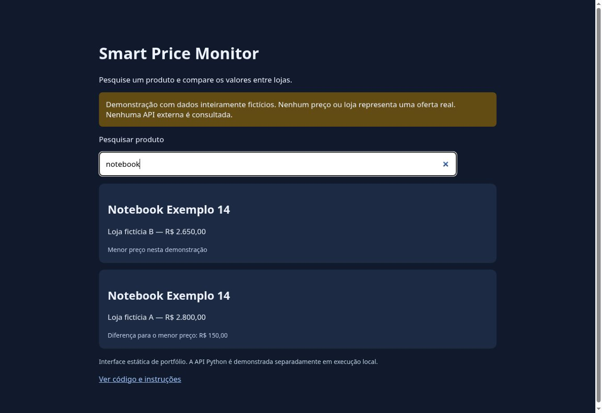

# Smart Price Monitor

Projeto Python de monitoramento e comparação de preços, com coletores modulares, PostgreSQL, API FastAPI e dashboard Streamlit. **Estado: experimental; sem SaaS multiusuário ou coleta comercial homologada.**

Código: https://github.com/matheuz-code/smart-price-monitor

## Demonstração online

https://matheuz-code.github.io/smart-price-monitor/

Interface estática de portfólio no GitHub Pages, com pesquisa, comparação e estado sem resultados. Os quatro registros são inteiramente fictícios; não há consulta a lojas, preços reais ou APIs externas. A API Python é demonstrada separadamente em execução local.



## Demonstração gratuita sem configuração

```bash
python demo.py
```

Abra http://127.0.0.1:8000. Pesquise notebook ou mouse para comparar lojas. A tela e `/api/produtos` usam **dados fictícios**, claramente identificados, sem consultar lojas, APIs, banco ou serviços externos. Não há oferta real. Este servidor é para demonstração local, não para produção pública.

## Arquitetura

- `scrapers/`: coletores existentes; alguns experimentais ou desativados.
- `agent.py`: coordena coleta, persistência e classificação de quedas.
- `database/db.py`: PostgreSQL por `DATABASE_URL`, sem senha fixa em código.
- `api.py`: consulta produtos e histórico via FastAPI.
- `dashboard.py`: filtros e gráficos com Streamlit e Pandas.
- `pricing.py`: normalização compartilhada de preços e separadores.
- `demo.py`: pesquisa e comparação sem infraestrutura externa.

## Implementação completa

```bash
python -m venv .venv
# Ative o ambiente virtual conforme seu sistema.
python -m pip install -r requirements.txt
# Defina DATABASE_URL para um PostgreSQL próprio de desenvolvimento.
python -m uvicorn api:app --host 127.0.0.1 --port 8001
python -m streamlit run dashboard.py
```

As tabelas `produtos` e `quedas_detectadas` precisam existir. A versão legada ainda não possui migrações automatizadas. A demonstração acima funciona sem essa instalação e é recomendada para avaliação rápida.

## Testes

```bash
python -m unittest discover -s tests -v
```

**7 testes aprovados**: formatos de moeda, milhar/decimal, valores inválidos, busca, comparação e preservação da origem. Compilação sintática também verificada. PostgreSQL, coleta ao vivo e dashboard completo não foram homologados nesta revisão.

## Limitações e custo

Fontes externas podem falhar por alterações de HTML, autenticação, CAPTCHA ou bloqueios. Não contorne esses mecanismos: interrompa a coleta. O coletor Mercado Livre é experimental e pode associar títulos, preços e links incorretamente. Magalu e Casas Bahia estão desativados. XLSX históricos não representam preços atuais. Não há autenticação, isolamento entre usuários ou agendamento hospedado. O projeto não é um SaaS comercial concluído.

Nenhum plano pago, assinatura, cartão ou API paga é necessário para a demonstração, feita somente com a biblioteca padrão do Python. O README anterior foi preservado em `docs/README_HISTORICO.md` como histórico; o estado atual é descrito neste arquivo.
